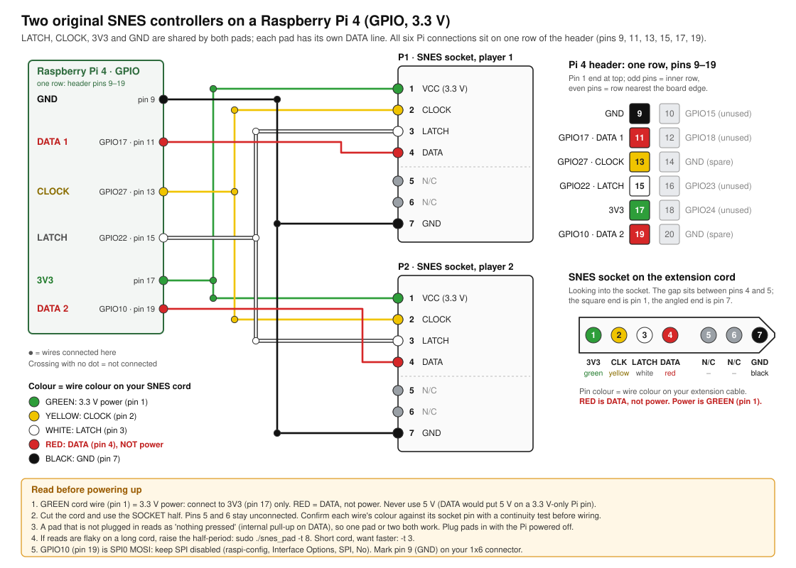
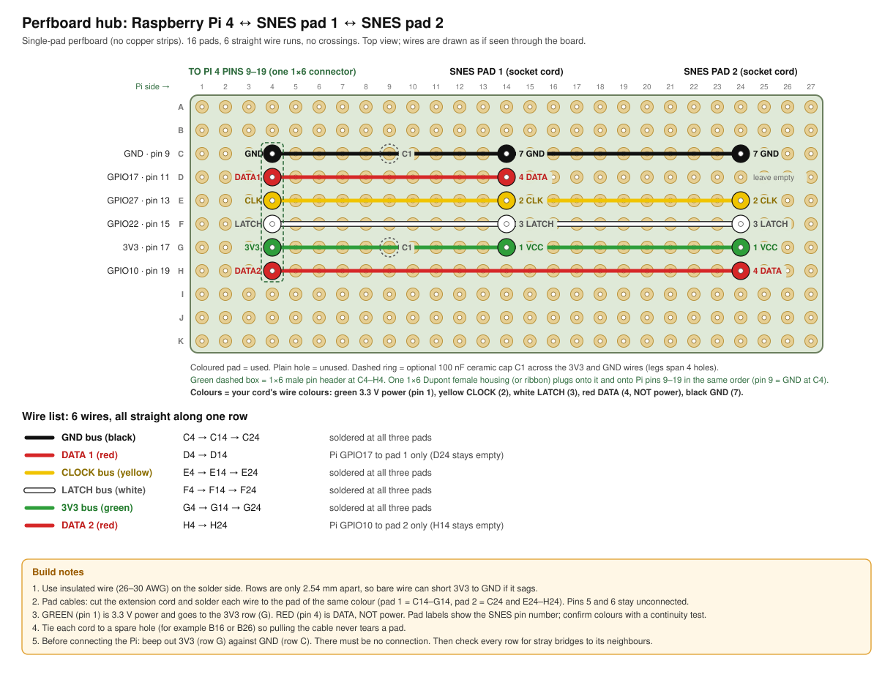

# Mini Super Nintendo: original SNES controllers on a Raspberry Pi 4, near-zero latency

Plug **original Super Nintendo / Super Famicom controllers** straight into the GPIO header of a Raspberry Pi 4 and use them in RetroArch / RetroPie / any Linux software. There is no microcontroller and no USB in between. A small real-time daemon reads the pads directly and presents them to Linux as normal gamepads.

- **Up to 2 pads**, on one 1×6 header row (a single connector plugs in everything)
- **~0.12 – 0.66 ms** average added latency, versus roughly 4 – 5 ms for a typical USB SNES pad (details in [docs/LATENCY.md](docs/LATENCY.md))
- **No extra parts beyond a few wires:** cut a SNES extension cord in half and use the socket half
- Built for a Mini Super Nintendo / Super Famicom 3D-printed case (CAD and STL files in [`hardware/`](hardware/))



## Quick start

1. **Build the wiring**, following [docs/BUILD_GUIDE.md](docs/BUILD_GUIDE.md). It takes six wires and one perfboard.
2. **Install the software** on the Pi:
   ```bash
   git clone https://github.com/415labs/Mini-Super-Nintendo.git
   cd Mini-Super-Nintendo
   bash install.sh -n 2        # use -n 1 if you only have one pad
   ```
3. **Test the pads:**
   ```bash
   sudo python3 software/snes_test.py --evdev -n 2
   ```
   Press every button. Each one should light up on the first press.
4. **Set up RetroArch:** see [docs/RETROARCH.md](docs/RETROARCH.md).

## What you need

| Item | Notes |
|---|---|
| Raspberry Pi 4 (or Pi 400 / CM4) | **Pi 4 only.** The daemon uses BCM2711 registers directly, so Pi 3 and Pi 5 will not work. |
| Original SNES / Super Famicom controllers | The author used original Nintendo pads powered at **3.3 V**. See the 5 V note below. |
| 1 SNES extension cord per pad | Cut in half; you keep the socket half. |
| Perfboard, about 27×11 holes | Optional: you can also wire directly to a header. |
| 1×6 male pin header (2.54 mm) and a matching 1×6 female connector | Connects the hub to Pi header pins 9–19. |
| Hookup wire, solder, a multimeter | The multimeter matters, see "Check your wire colours" below. |
| 100 nF capacitor (optional) | Across 3V3 and GND near the pad connections. |

## How it connects

All six Pi connections are on **one row of the 40-pin header**:

| Header pin | 9 | 11 | 13 | 15 | 17 | 19 |
|---|---|---|---|---|---|---|
| Signal | GND | DATA 1 | CLOCK | LATCH | 3V3 | DATA 2 |
| GPIO (BCM) | – | 17 | 27 | 22 | – | 10 |

CLOCK, LATCH, 3V3 and GND are shared by both pads, as on a real SNES. Each pad has its own DATA wire.

SNES socket pinout, looking into the socket (square end is pin 1, angled end is pin 7):

| Pin | 1 | 2 | 3 | 4 | gap | 7 |
|---|---|---|---|---|---|---|
| Signal | VCC | CLOCK | LATCH | DATA | (5, 6 unused) | GND |



### Check your wire colours

**Cord wire colours differ between manufacturers.** The diagrams use the author's cord (pin 1 green, 2 yellow, 3 white, 4 red, 7 black). Note that **red is DATA, not power**. Do not trust colours. Use a multimeter in continuity mode to match each wire to a socket pin before you connect anything. Putting 3.3 V onto the wrong line can damage the Pi. [docs/BUILD_GUIDE.md](docs/BUILD_GUIDE.md) shows how.

### Power: 3.3 V, not 5 V

The pads are powered from the Pi's 3.3 V pin. The Pi's GPIO pins are **not 5 V tolerant**. A pad powered from 5 V would drive DATA to 5 V and could damage the Pi. Original Nintendo pads work at 3.3 V. If you have a pad that needs 5 V, put level shifters on all three signal lines. Do not connect it directly.

### Keep SPI off

Pad 2's DATA uses GPIO10, which is the SPI0 MOSI pin. Leave SPI disabled (`raspi-config` → Interface Options → SPI → No).

## Software

| File | What it does |
|---|---|
| [`software/snes_pad.c`](software/snes_pad.c) | The daemon. Polls the pads over GPIO and creates virtual gamepads ("SNES GPIO Pad 1/2") through `uinput`. |
| [`software/snes_test.py`](software/snes_test.py) | Test and diagnosis tool: live button display, wiring check, raw bit view. |
| [`software/snes-pad.service`](software/snes-pad.service) | systemd unit, filled in by `install.sh`. |
| [`install.sh`](install.sh) | Builds, installs and starts everything. `bash install.sh --uninstall` removes it. |

Daemon options:

```
snes_pad [-n pads] [-r poll_hz] [-t half_period_us] [-a cpu] [-v]
  -n  number of pads, 1 or 2          (default 2)
  -r  polling rate in Hz              (default 1000, max 8000)
  -t  half clock period in microsec   (default 6 = original SNES timing)
  -a  pin to a CPU core               (use with isolcpus=<n>)
  -v  print raw button state on every change
```

Only one copy of the daemon can run at a time. A second one exits with a message instead of scrambling the reads. Stop the service first (`sudo systemctl stop snes-pad`) if you want to run it by hand.

## Documentation

- [Build guide](docs/BUILD_GUIDE.md): cutting the cords, identifying wires, soldering the hub
- [RetroArch setup](docs/RETROARCH.md): binding the pads and the settings that cut latency
- [Latency and tuning](docs/LATENCY.md): numbers, comparison with USB, how to go faster
- [Troubleshooting](docs/TROUBLESHOOTING.md): flaky buttons, one dead port, nothing detected
- [How it works](docs/HOW_IT_WORKS.md): the SNES protocol and the daemon design

## 3D-printed case

CAD sources go in [`hardware/cad/`](hardware/cad/) and printable files in [`hardware/stl/`](hardware/stl/). Both folders are placeholders until the files are added.

## License

Software and documentation: MIT, see [LICENSE](LICENSE). The CAD and STL files may carry their own license; see the notes in `hardware/`.

SNES, Super Nintendo and Super Famicom are trademarks of Nintendo. This project is not affiliated with or endorsed by Nintendo.
