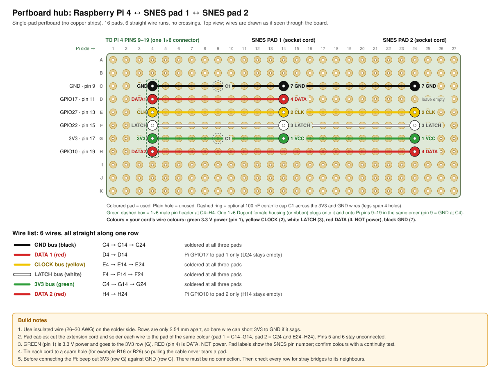

# Build guide

You will wire up to two SNES sockets to a perfboard "hub", then connect the hub to the Pi with one 1×6 connector.

## 1. Prepare the extension cords

1. Cut each SNES extension cord in the middle. Keep the **socket half** (the end where a controller plugs in). The plug half is not needed.
2. Strip the outer jacket back about 4 cm and strip about 3 mm from each inner wire. A SNES cord has five wires inside: VCC, CLOCK, LATCH, DATA and GND.
3. Tin the wire ends lightly with solder.

## 2. Identify every wire with a multimeter

**Do this for every cord.** Wire colours are not standardised.

Socket pinout, looking into the socket where the controller plugs in. The square end is pin 1 and the angled end is pin 7. There is a gap between pins 4 and 5, and pins 5 and 6 are not connected.

| Pin | Signal |
|---|---|
| 1 | VCC |
| 2 | CLOCK |
| 3 | LATCH |
| 4 | DATA |
| 5, 6 | not connected |
| 7 | GND |

1. Set the meter to continuity (beep) mode.
2. Push a bent paperclip or a bare solid wire into the socket pin you are testing.
3. Touch the other probe to each cut wire in turn until it beeps. Write the colour down.
4. Repeat for pins 1, 2, 3, 4 and 7.

Write the result in a table like this one, using your own colours:

| Socket pin | Signal | Wire colour |
|---|---|---|
| 1 | VCC | _ |
| 2 | CLOCK | _ |
| 3 | LATCH | _ |
| 4 | DATA | _ |
| 7 | GND | _ |

The author's cords were pin 1 green, 2 yellow, 3 white, 4 red, 7 black. The red wire is DATA and **not** power.

Also check that no two wires in the cord are shorted to each other, and that every wire reads well under 2 Ω from the socket pin to the cut end. A bad contact inside a socket causes flaky or missing buttons (see [Troubleshooting](TROUBLESHOOTING.md)).

## 3. Solder the hub

The hub is a 27×11 hole perfboard. Rows C to H carry one signal each, in the same order as the Pi header pins. Columns carry the connections:

| Row | Signal | Pi pad (col 4) | Pad 1 (col 14) | Pad 2 (col 24) |
|---|---|---|---|---|
| C | GND | C4 (header pin 9) | C14 | C24 |
| D | DATA 1 | D4 (pin 11, GPIO17) | D14 | not used |
| E | CLOCK | E4 (pin 13, GPIO27) | E14 | E24 |
| F | LATCH | F4 (pin 15, GPIO22) | F14 | F24 |
| G | 3V3 | G4 (pin 17) | G14 | G24 |
| H | DATA 2 | H4 (pin 19, GPIO10) | not used | H24 |

1. Solder a **1×6 male header** into C4 to H4. This is the connector to the Pi.
2. Run six straight wires along the rows: C4 to C24, E4 to E24 and so on, joining each row's pad columns. The diagram shows exactly which holes to link.
3. Solder each cord's wires to the pad column for its port, using your wire-colour table. Pad 1 uses D14 for DATA. Pad 2 uses H24 for DATA.
4. Optional: a 100 nF capacitor across row G (3V3) and row C (GND) near column 9 steadies the pad supply.
5. **Clean flux residue** with isopropyl alcohol. Rows G and H are next to each other, and flux leakage between VCC and DATA can cause weak or missing presses.

## 4. Check the hub before connecting the Pi

With the Pi **off** and nothing plugged into the hub, use the multimeter:

1. **Continuity along each row.** The pad at column 4 should connect to the pad at column 14 or 24 (resistance under about 2 Ω).
2. **No shorts between rows.** On the highest resistance range, every pair of different rows should read open (OL or above 1 MΩ). The pair that matters most is **3V3 (row G) to GND (row C)**. If it shows any low reading, stop and find the short.
3. **Socket to hub.** For each port, measure from each socket pin to its hub pad, with the pad unplugged. Each reading should be under about 2 Ω and steady while you flex the cord.

## 5. Connect to the Pi

The 1×6 connector goes on header pins 9, 11, 13, 15, 17 and 19, which is one row of the 40-pin header: the odd-numbered pins. Pin 1 is at the end of the header nearest the SD card slot, and the 5 V pins (2 and 4) are on the other row, along the board edge. So the odd pins form the inner row, and pin 9 is the fifth pin from the SD-card end of that row. Confirm against a Raspberry Pi pinout chart (for example the one at [pinout.xyz](https://pinout.xyz)) before you power on.

| Header pin | 9 | 11 | 13 | 15 | 17 | 19 |
|---|---|---|---|---|---|---|
| Signal | GND | DATA 1 | CLOCK | LATCH | 3V3 | DATA 2 |

Check the orientation twice before powering the Pi. GND is pin 9 and 3V3 is pin 17. A header plugged in reversed puts 3V3 on the wrong pin.

1. Power the Pi off while you plug the connector in.
2. With the Pi on but the pads unplugged, measure between G24 (VCC) and C24 (GND). You should read about 3.3 V.
3. Plug in a pad and continue to [software installation](../README.md#quick-start).

## 6. Mounting in the case

The 3D-printed case files are in [`hardware/`](../hardware/). Keep the cords short and strain-relieved so a tug on a pad cable never pulls on a solder joint.
